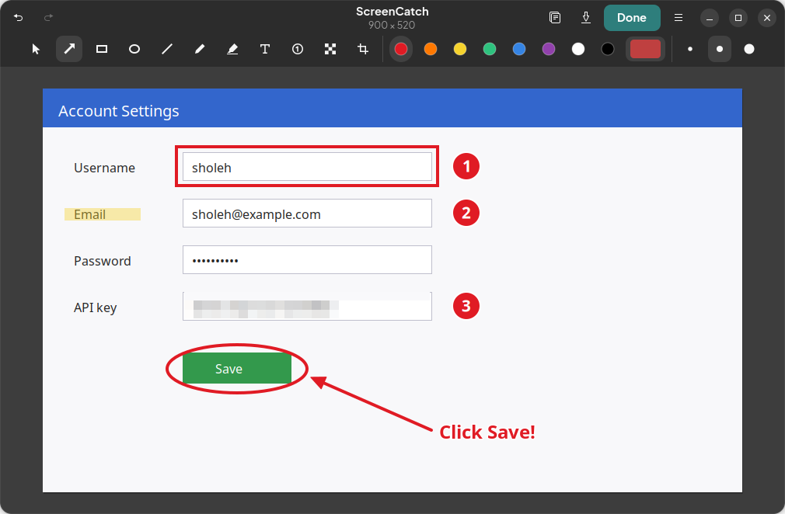

<div align="center">
  

# ScreenCatch

**Take a screenshot and mark it up — instantly.**

Press a shortcut, drag over what you need, add arrows, boxes, circles and text, then copy or save.
No more saving a screenshot just to open it again in another editor.

[](https://github.com/sholehbaktiabadi/screencatch/actions/workflows/ci.yml)
[](https://github.com/sholehbaktiabadi/screencatch/releases/latest)
[](LICENSE)


</div>

## Features

- **One flow** — the screen freezes, you drag a region, and the editor opens right away.
- **Annotation tools** — arrow, rectangle, ellipse, line, pen, highlighter, text, numbered steps (1, 2, 3…).
- **Pixelate** passwords, emails or faces before sharing.
- **Edit freely** — move, recolor, resize or delete any annotation, crop, unlimited undo/redo.
- **Copy or save in one key** — the clipboard keeps working after the editor closes.
- **Global shortcut** — <kbd>Ctrl</kbd>+<kbd>Shift</kbd>+<kbd>Print</kbd> is set up automatically on GNOME.
- **Wayland and X11** through the standard XDG screenshot portal; HiDPI and multi-monitor aware.
- Native GTK 4 / libadwaita interface that follows the light and dark system style.

## Install

Download the latest `screencatch_<version>_all.deb` from the
[Releases page](https://github.com/sholehbaktiabadi/screencatch/releases/latest) and install it with apt,
which pulls in the dependencies:

```sh
sudo apt install ./screencatch_1.0.0_all.deb
```

**Supported:** Ubuntu 24.04 or newer, Debian 13 or newer, and derivatives
(needs GTK ≥ 4.12, libadwaita ≥ 1.5 and `xdg-desktop-portal`).
The GNOME desktop gets the automatic shortcut; other desktops work too, but you bind the key yourself.

To uninstall: `sudo apt remove screencatch`.

## Usage

| How | What happens |
| --- | --- |
| <kbd>Ctrl</kbd>+<kbd>Shift</kbd>+<kbd>Print</kbd> | Freeze the screen and select a region |
| App grid → **ScreenCatch** | Main window: capture region / whole screen, optional delay |
| Right-click the app icon | Capture Region, Capture Whole Screen, Capture in 3 Seconds |
| Files → *Open With* → ScreenCatch | Annotate an existing PNG or JPEG |

### Selecting a region

Drag to select, then use the handles to adjust. Next to the selection you can:

| Key | Action |
| --- | --- |
| <kbd>Enter</kbd> / double-click | Open the editor (configurable) |
| <kbd>Ctrl</kbd>+<kbd>C</kbd> | Copy the region without editing |
| <kbd>Ctrl</kbd>+<kbd>S</kbd> | Save the region without editing |
| <kbd>Space</kbd> | Select the whole monitor |
| Arrow keys | Move the selection (<kbd>Shift</kbd>: 10 px, <kbd>Ctrl</kbd>: resize) |
| <kbd>Esc</kbd> / right-click | Cancel |

### Editor

| Key | Tool | | Key | Action |
| --- | --- | --- | --- | --- |
| <kbd>V</kbd> | Select and move | | <kbd>Ctrl</kbd>+<kbd>Enter</kbd> | **Done** (copy + save + close, configurable) |
| <kbd>A</kbd> | Arrow | | <kbd>Ctrl</kbd>+<kbd>C</kbd> | Copy to clipboard |
| <kbd>R</kbd> | Rectangle | | <kbd>Ctrl</kbd>+<kbd>S</kbd> | Save |
| <kbd>E</kbd> | Ellipse | | <kbd>Ctrl</kbd>+<kbd>Shift</kbd>+<kbd>S</kbd> | Save as… |
| <kbd>L</kbd> | Line | | <kbd>Ctrl</kbd>+<kbd>Z</kbd> | Undo |
| <kbd>P</kbd> | Pen | | <kbd>Ctrl</kbd>+<kbd>Shift</kbd>+<kbd>Z</kbd> | Redo |
| <kbd>H</kbd> | Highlighter | | <kbd>Delete</kbd> | Delete selected annotation |
| <kbd>T</kbd> | Text | | <kbd>Esc</kbd> | Deselect / close |
| <kbd>N</kbd> | Numbered step | | <kbd>Shift</kbd> (hold) | Square, circle, 45° lines |
| <kbd>B</kbd> | Pixelate | | | |
| <kbd>C</kbd> | Crop | | | |

With the select tool, click an annotation and pick another color or size to change it.
Double-click a text annotation to edit it.

### Command line

```text
screencatch                 capture a region (default)
screencatch --full          capture the whole screen into the editor
screencatch --delay 5       wait 5 seconds first
screencatch --home          open the main window
screencatch image.png       annotate an existing image
screencatch --debug         print diagnostic messages
```

Screenshots are saved to `~/Pictures/Screenshots` by default; change the folder and the
file name template (strftime codes such as `%Y-%m-%d`) in **Preferences**.

## FAQ

**The shortcut does nothing.**
Open ScreenCatch once from the app grid; it registers the shortcut on first start. Check
*Preferences → Global Shortcut*, or *GNOME Settings → Keyboard → Custom Shortcuts*, where it is listed as
“ScreenCatch: capture region”. On non-GNOME desktops, bind a key to the command `screencatch`.

**An “Allow Screen Capture” window appears on the first capture.**
GNOME has to approve screen capture once, and it only shows its permission dialog while the app has
focus. Click **Allow Screen Capture**, then **Allow** in GNOME's dialog; it is remembered and later
captures run silently. If you clicked *Deny* earlier, the same button asks again.

**Why does ScreenCatch keep running after I copied?**
On Wayland, clipboard data is served by the app that copied it. ScreenCatch stays in the background
(without windows) until you copy something else, so your paste keeps working.

## Building from source

```sh
sudo apt install meson python3-gi python3-gi-cairo python3-cairo gir1.2-gtk-4.0 gir1.2-adw-1 \
    desktop-file-utils appstream libglib2.0-bin debhelper devscripts lintian
make test      # unit tests and metadata validation
./run-dev.sh   # run from the source tree
make deb       # build dist/screencatch_<version>_all.deb
```

Or install system-wide with meson directly:

```sh
meson setup _build --prefix=/usr/local
sudo meson install -C _build
```

See [CONTRIBUTING.md](CONTRIBUTING.md) for the code layout and release process.

## License

[MIT](LICENSE) © 2026 Sholeh Bakti Abadi
